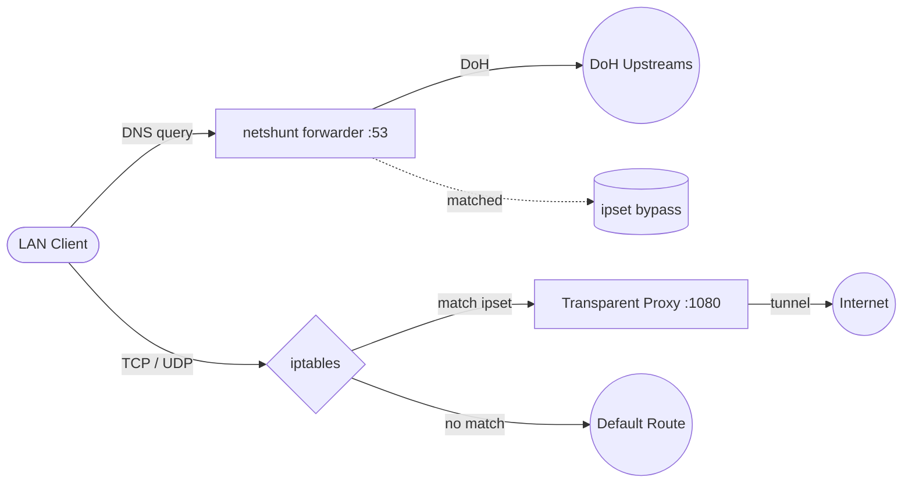

# netshunt

Selective traffic routing through a transparent proxy for Keenetic routers.

netshunt routes specific domains, IPs, and CIDRs through a transparent proxy while everything else uses the default connection. It runs on Keenetic routers with [Entware](https://github.com/Entware/Entware) and manages the entire split-tunneling pipeline: DNS resolution, ipset population, and iptables redirection.

## Features

- **Shunt-based routing** - organize domains, IPs, and CIDRs into named shunts, enable/disable entire shunts at once
- **Geosite integration** - import curated domain categories from the [v2fly domain-list-community](https://github.com/v2fly/domain-list-community) (google, netflix, facebook, and 1400+ more)
- **Web dashboard** - manage shunts, browse geosite categories, view status, adjust settings, run diagnostics
- **HTTP API** - full API for scripting and automation
- **Encrypted DNS** - the built-in forwarder resolves over DNS-over-HTTPS (Google, Cloudflare and Quad9 by default, queried in parallel, first answer wins) with a response cache; no separate resolver to install
- **Automatic IP tracking** - DNS forwarder populates ipset in real-time; tracked IPs persist until the domain is removed or the daemon restarts
- **TCP + UDP** - NAT REDIRECT for TCP, TPROXY for UDP. IPv4 only (AAAA queries are answered with an empty answer to prevent IPv6 bypass)
- **Keenetic integration** - NDM hooks restore rules on reboots, WAN changes, interface restarts
- **Multi-interface / road-warrior** - apply the same shunt routing to extra ingress interfaces (e.g. an AmneziaWG/WireGuard TUN) via `network.additional_interfaces`, so remote VPN clients hit the same bypass list as the LAN
- **Proxy-agnostic** - redirects to a local port, any transparent proxy works

## How It Works



## Quick Start

```sh
# Download the latest IPK from GitHub Releases
opkg install netshunt_x.x.x_aarch64.ipk

# Run the interactive setup wizard
netshunt setup

# Open the web UI at http://<router-ip>:8765 to add domains
```

## Requirements

- Keenetic router with Entware (aarch64)
- A transparent proxy listening on a local port (e.g. Shadowsocks, xray, sing-box, Hysteria 2)
- SSH access to the router

System dependencies (`ipset`, `iptables`, `conntrack`) are installed automatically as opkg dependencies.

## Building from Source

Requires Go 1.25+ and [Mage](https://magefile.org/).

```sh
# Build for host platform
mage build

# Cross-compile for router (aarch64)
mage buildRouter

# Build IPK package
mage package

# Run tests
mage test
```

## License

MIT
